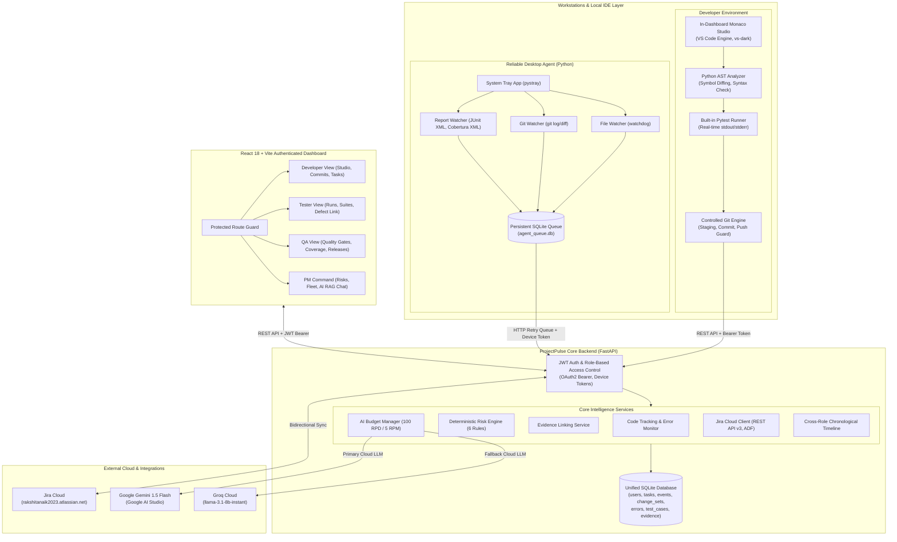

# PROJECTPULSE AI — COMPREHENSIVE SYSTEM ARCHITECTURE & PROJECT OVERVIEW
> **Master Reference Document for LLM Context Ingestion, Architectural Walkthroughs, and Technical Audits**  
> *Version: 2.1.0 | Status: Production-Ready & Verified | Framework: FastAPI + React 18 (Vite) + Python Desktop Agent + SQLite*

---

## 1. Executive Summary & Problem Space

### 1.1 The Core Problem: The "Plan vs. Reality" Gap
In modern software engineering, teams manage work across external Project Management (PM) systems like **Jira, Trello, Linear, Asana, Monday, and ClickUp**. Sprints are planned, tasks are assigned, and roadmaps are drawn. However, a systemic disconnect exists between **what is written on PM tickets** and **what is actually occurring on team workstations**:
1. **Ghost Tasks:** A Jira ticket is marked `"In Progress"`, but the developer has stopped committing code for days or is blocked by an unrecorded compiler issue.
2. **Unlinked Shadow Work:** Developers refactor core subsystems or fix bugs without any associated ticket, blinding project managers to actual scope churn.
3. **Silent Quality Gate Breaches:** Unit, integration, or regression tests break locally on a developer or tester machine, yet the PM board indicates the feature is ready for QA.
4. **Late Defect Discovery:** QA identifies high-severity defects at the end of the sprint because test coverage drops were invisible during active development.
5. **Status Meeting Overhead:** Project Managers spend hours chasing asynchronous updates, leading to surprises, schedule slippages, and release delays.

### 1.2 The ProjectPulse Solution
**ProjectPulse AI** is a role-aware, privacy-preserving, background project intelligence platform. It bridges this gap by:
* Running a lightweight **Desktop Agent** on workstation machines to non-invasively capture development (Git, AST symbol diffs, build errors), testing (Pytest, JUnit XML), and QA (coverage XML, defects) telemetry.
* Providing an **In-Dashboard Monaco Code Studio** for developers with real-time AST parsing, automated syntax error monitoring, built-in test runners, and controlled Git finalization.
* Integrating bi-directionally with real **Jira Cloud** instances (and an offline Local Task Board).
* Normalizing heterogeneous workstation telemetry into a unified SQLite data layer.
* Evaluating **6 Deterministic Plan-vs-Reality Risk Rules** locally without external LLM dependencies.
* Equipping Project Managers with an **AI Project Assistant** using Retrieval-Augmented Generation (RAG) with strict citations to ground-truth event IDs and task keys.
* Safeguarding API quotas with an **AI Budget Manager** featuring multi-tier fallback (Google Gemini 1.5 Flash ➔ Groq LLaMA 3.1 8B ➔ Local Deterministic Synthesis Engine).

---

## 2. High-Level System Architecture



---

## 3. Four-Role Workstation & Dashboard Model

ProjectPulse enforces strict Role-Based Access Control (RBAC). Every endpoint and view requires authentication and role authorization:

### 3.1 Developer Experience
* **Live Monaco Code Studio:** Full code editor inside the web dashboard powered by `@monaco-editor/react`. Includes syntax highlighting, code folding, line numbers, and dark theme (`vs-dark`).
* **Sandboxed Workspace Explorer:** Safely inspects files in `showcase_project/` with path-traversal protection (`os.path.commonpath`).
* **Real-Time AST Change Sets:** On every `Ctrl+S`, the backend parses the AST (`ast.parse`), extracts modified functions and classes, and groups changes into atomic `ChangeSetRecord` (`CS-XXXX`) entries.
* **Centralized Error & Quality Monitor:** Automatically captures syntax errors and test failures, displaying exact file and line locations. Errors are only marked `RESOLVED` after real verification (AST re-parsing or pytest execution).
* **Controlled Git Finalization:** Prevents uncontrolled pushing. Developers review line diffs, verify 0 critical errors exist, write a commit message, and explicitly execute local commit and remote push.
* **Telemetry & Activity:** Tracks local commits, branch switches, and file modifications linked to Jira tickets.

### 3.2 Tester Experience
* **Tester Overview Dashboard:** Landing page displaying test executions today, historical pass/fail/skip rates, pending regression test runs, and agent sync status.
* **Test Case Management:** Structured authoring of test cases grouped into suites (e.g., `Authentication`, `Checkout Flow`). Testers define preconditions, execution steps, expected results, priorities (`CRITICAL`, `HIGH`, `MEDIUM`, `LOW`), and execution status (`DRAFT`, `READY`, `PASSED`, `FAILED`, `BLOCKED`).
* **Test Failure-to-Jira Defect Linking:** Connects failed tests directly to Jira defect tickets (e.g., `PP-3`), showing real-time defect status and assignee.
* **Automated Test Report Watcher:** The desktop agent automatically watches for JUnit XML (`pytest --junitxml=report.xml`) and TestNG XML files, parsing test outcomes and streaming them to the backend without manual test uploads.

### 3.3 Quality Assurance (QA) Experience
* **Quality Gate Command:** Evaluates whether a build meets release criteria based on test pass rates, defect severity thresholds, and test coverage metrics.
* **Code Coverage Analytics:** Ingests Cobertura and JaCoCo XML reports generated by `coverage.py` (`coverage xml`) or Maven/Gradle, tracking line-rate, branch-rate, and module-level coverage.
* **Defect Lifecycle Management:** Tracks defects from discovery (`OPEN`) through verification (`VERIFIED`) to closure (`CLOSED`), preventing releases if critical defects remain unresolved.
* **Release Verdicts:** QA Engineers record explicit release verdicts (`APPROVED`, `CONDITIONAL_PASS`, `BLOCKED`) with audit logs.

### 3.4 Project Manager (PM) Experience
* **Plan vs. Reality Discrepancy Dashboard:** Live scorecard powered by the 6 deterministic risk rules.
* **AI Project Assistant (RAG Grounded):** Natural language Q&A interface citing specific task keys (`PP-1`), commit hashes, and event IDs.
* **Fleet Workstation Monitor:** Displays active desktop agents, workstation hostnames, OS types, last heartbeat timestamps, and queue health.
* **Unified Sprint & Backlog Board:** Integrates tasks from live Jira Cloud (`PP` project) and the offline Local Task Board.
* **User & Credential Management:** Administer users, reset pairing tokens, and trigger on-demand Jira synchronizations.

---

## 4. Key Subsystems Deep Dive

### 4.1 In-Dashboard Code Studio & Controlled Git Synchronization
* **Implementation File:** [backend/services/code_tracking_service.py](file:///c:/Users/kingn/OneDrive/Desktop/projectpulse/projectpulse/backend/services/code_tracking_service.py)
* **Frontend Component:** [frontend/src/components/CodeStudioView.jsx](file:///c:/Users/kingn/OneDrive/Desktop/projectpulse/projectpulse/frontend/src/components/CodeStudioView.jsx)

#### The Problem It Solves
Developers often modify code across several files, introduce syntax errors, or break test suites without committing. Conversely, auto-committing on every save pollutes Git history with broken code.

#### How It Operates
1. **Sandboxing:** Path traversal protection prevents reading or saving files outside the active workspace directory:
   ```python
   target_abs = os.path.abspath(os.path.join(workspace_path, relative_path))
   if os.path.commonpath([workspace_path, target_abs]) != workspace_path:
       raise PermissionError("Access denied: Path traversal detected")
   ```
2. **AST Symbol Intelligence:** On file save, Python's `ast` module parses the file. It extracts class definitions (`ast.ClassDef`) and function/method definitions (`ast.FunctionDef`, `ast.AsyncFunctionDef`), diffing them against the baseline to compute modified symbols.
3. **Automated Error Verification:**
   * If `ast.parse()` raises `SyntaxError`, an `ErrorRecord` is created with `severity="CRITICAL"`, storing the line number and message.
   * When the user fixes the error and saves, `ast.parse()` succeeds, and the error record status is automatically transitioned from `ACTIVE` to `RESOLVED` with `verification_method="AST_PARSE"`.
4. **Pytest Engine:** Executes `pytest` in a sandboxed subprocess within `showcase_project/`, parses the output with regular expressions (`r"(\d+) passed"`, `r"(\d+) failed"`), and captures failures into `ErrorRecord`.
5. **Controlled Git Finalization Gate:**
   * Finalization is blocked if any `CRITICAL` or `HIGH` errors remain active.
   * When approved, the service runs `git add .`, commits with the developer's message, updates the change set to `FINALIZED`, and pushes to the configured remote repository.

---

### 4.2 Desktop Agent Architecture & Offline Resilience
* **Implementation Directories:** [agent/](file:///c:/Users/kingn/OneDrive/Desktop/projectpulse/projectpulse/agent/)
* **Key Modules:**
  * `tray_app.py`: System tray icon using `pystray` with single-instance mutex lock (`.agent.lock`).
  * `event_queue.py`: Persistent SQLite queue (`agent_queue.db`) providing zero-data-loss telemetry transmission even during backend downtime.
  * `collectors/report_watcher.py`: Background XML file watcher parsing JUnit XML and Cobertura coverage reports.
  * `ast_analyzer.py`: Client-side AST symbol extractor ensuring raw source code never leaves the workstation.

#### Workstation Privacy Guarantees
* **Zero Keylogging / Zero Screen Grabs:** The agent never listens to keyboard input or captures displays.
* **Source Code Never Leaves Workstation:** The agent transmits only structural facts:
  * Modified file path and line delta (`+14, -3`).
  * Extracted AST symbol names (`def process_payment()`).
  * Test result counts (`5 passed, 1 failed`).
* **Allowlist Filtering:** Monitors only directories declared in `agent_config.json`, ignoring `.git`, `node_modules`, `venv`, and secrets.

---

### 4.3 Deterministic Plan-vs-Reality Risk Engine
* **Implementation File:** [backend/services/risk_service.py](file:///c:/Users/kingn/OneDrive/Desktop/projectpulse/projectpulse/backend/services/risk_service.py)

The engine evaluates 6 deterministic, explainable rules locally on SQLite data. It produces actionable alerts with explicit rationale and recommendations:

| Rule Code | Rule Name | Condition Evaluated | Severity | Recommendation |
| :--- | :--- | :--- | :--- | :--- |
| **RULE-1** | `UNLINKED_DEV_ACTIVITY` | Git commits or file edits detected on a branch with no matching Jira task key. | `HIGH` | Prompt developer to create or link an existing ticket before continuing work. |
| **RULE-2** | `TASK_OVERDUE_STAGNANT` | Task status is `IN_PROGRESS` but zero telemetry events recorded for > 48 hours. | `HIGH` | Ping assignee to verify blockers, dependencies, or unrecorded offline work. |
| **RULE-3** | `TEST_FAILURE_SPIKE` | Test failures spike by > 30% in recent test runs or pass rate falls below 80%. | `CRITICAL` | Halt feature merges; trigger immediate regression root-cause analysis. |
| **RULE-4** | `BUILD_FAILURE_UNRESOLVED` | Build collector records 3+ consecutive compiler/build errors on a project branch. | `HIGH` | Notify lead developer of broken build pipeline blocking team testing. |
| **RULE-5** | `UNVERIFIED_HIGH_DEFECTS` | 2+ `CRITICAL` or `HIGH` QA defects remain in `OPEN` status without developer assignment. | `CRITICAL` | Schedule sprint triage; block release candidate until defects are triaged. |
| **RULE-6** | `COVERAGE_BELOW_GATE` | Total line coverage drops below the project quality gate threshold (e.g., 75%). | `MEDIUM` | Require unit tests for newly modified classes before allowing PR approval. |

---

### 4.4 Centralized AI Budget Manager & Multi-Tier Fallback
* **Implementation File:** [backend/services/ai_budget_manager.py](file:///c:/Users/kingn/OneDrive/Desktop/projectpulse/projectpulse/backend/services/ai_budget_manager.py)
* **Integration Module:** [backend/services/ai_service.py](file:///c:/Users/kingn/OneDrive/Desktop/projectpulse/projectpulse/backend/services/ai_service.py)

To prevent breaking free API limits or failing during offline academic evaluations, ProjectPulse wraps all AI operations with an AI Budget Manager:

```
[User Query]
     │
     ▼
[SHA-256 Prompt & Context Hash Check] ──(Hit)──> [Return Cached Response (0ms, 0 Tokens)]
     │ (Miss)
     ▼
[Check Daily Quota (<100) & Rate Limit (<5 RPM)]
     │
     ├─► [Tier 1: Google Gemini 1.5 Flash] ──(Success)──> [Store in Cache & Return]
     │        │ (Network Failure / Quota Exceeded)
     │        ▼
     ├─► [Tier 2: Groq LLaMA 3.1 8B Instant] ──(Success)──> [Store in Cache & Return]
     │        │ (Network Failure / Offline)
     │        ▼
     └─► [Tier 3: Local Deterministic Synthesis Engine] ──> [Format Context & Return Citing Keys]
```

* **Free-Tier Limits Respected:**
  * Gemini 1.5 Flash: 15 RPM / 1,500 RPD (ProjectPulse capped at 5 RPM / 100 RPD).
  * Groq LLaMA 3.1: 30 RPM / 14,400 RPD.
* **Zero Hallucination Grounding:** System prompts mandate that answers include source event IDs, task keys, and commit hashes. If information is not in the SQLite context, the assistant states: `"Insufficient project telemetry available to answer this query."`

---

### 4.5 Live Jira Cloud Integration & Local Task Board
* **Implementation Directory:** [backend/integrations/jira/](file:///c:/Users/kingn/OneDrive/Desktop/projectpulse/projectpulse/backend/integrations/jira/)
* **Verified Real Instance:**
  * **Base URL:** `https://rakshitanaik2023.atlassian.net`
  * **User Email:** `rakshitanaik2023@gmail.com`
  * **Project Key:** `PP`
  * **Real Issues:** `PP-1` (*Task*), `PP-2` (*Story*), `PP-3` (*Bug*)

#### Features
1. **Atlassian Document Format (ADF) Parser:** Extracts text content from Jira v3 nested JSON rich-text fields.
2. **Bidirectional Commenting:** Posting a comment in ProjectPulse calls `POST /rest/api/3/issue/{key}/comment` on Jira Cloud.
3. **Idempotent Upsert:** Synchronizing Jira tickets updates existing tasks without duplicating records or breaking linked workstation evidence.
4. **Offline Local Task Board:** When offline, Project Managers can create tasks directly in ProjectPulse. Local tasks follow identical schema and evidence-linking behavior as external Jira issues.

---

## 5. Complete Database Schema (SQLite / SQLAlchemy)

The database models are defined in [backend/models/db_models.py](file:///c:/Users/kingn/OneDrive/Desktop/projectpulse/projectpulse/backend/models/db_models.py):

```
┌─────────────────────────────────┐       ┌─────────────────────────────────┐
│              users              │       │            projects             │
├─────────────────────────────────┤       ├─────────────────────────────────┤
│ PK  user_id (String)            │       │ PK  project_id (String)         │
│     email (String, Unique)      │       │     name (String)               │
│     hashed_password (String)    │       │     description (Text)          │
│     name (String)               │       │     repo_path (String)          │
│     role (Enum: 4 Roles)        │       │     quality_gate_threshold(Fl)  │
│     is_active (Boolean)         │       │     created_at (DateTime)       │
│     created_at (DateTime)       │       └─────────────────────────────────┘
└─────────────────────────────────┘                        │ 1
                 │ 1                                       │
                 │                                         ▼ N
                 ▼ N                      ┌─────────────────────────────────┐
┌─────────────────────────────────┐       │              tasks              │
│       agent_registrations       │       ├─────────────────────────────────┤
├─────────────────────────────────┤       │ PK  task_id (String)            │
│ PK  registration_id (String)    │       │ FK  project_id (String)         │
│ FK  user_id (String)            │       │     external_id (String, "PP-1")│
│ FK  project_id (String)         │       │     title (String)              │
│     machine_name (String)       │       │     status (Enum: TODO/IN_PROG) │
│     device_token (String)       │       │     priority (Enum)             │
│     last_heartbeat (DateTime)   │       │     assigned_user_id (String)   │
│     is_active (Boolean)         │       │     created_at (DateTime)       │
└─────────────────────────────────┘       └─────────────────────────────────┘
                 │                                         │ 1
                 ▼                                         ▼ N
┌─────────────────────────────────┐       ┌─────────────────────────────────┐
│             events              │       │            evidence             │
├─────────────────────────────────┤       ├─────────────────────────────────┤
│ PK  event_id (String)           │◄──────│ PK  evidence_id (String)        │
│ FK  project_id (String)         │       │ FK  task_id (String)            │
│ FK  user_id (String)            │       │ FK  event_id (String)           │
│     event_type (Enum)           │       │     confidence (DIRECT/LIKELY)  │
│     source (GIT/FILE/TEST/QA)   │       │     link_reason (String)        │
│     details_json (Text)         │       │     created_at (DateTime)       │
│     timestamp (DateTime)        │       └─────────────────────────────────┘
└─────────────────────────────────┘
                 │ 1
                 ▼ N
┌─────────────────────────────────┐       ┌─────────────────────────────────┐
│           change_sets           │       │             errors              │
├─────────────────────────────────┤       ├─────────────────────────────────┤
│ PK  change_set_id (CS-XXXX)     │       │ PK  error_id (ERR-XXXX)         │
│ FK  project_id (String)         │       │ FK  project_id (String)         │
│ FK  user_id (String)            │       │ FK  change_set_id (String)      │
│     status (IN_PROGRESS/FINAL)  │       │     error_type (SYNTAX/TEST)    │
│     files_modified (JSON)       │       │     file_path (String)          │
│     symbols_changed (JSON)      │       │     line_number (Integer)       │
│     lines_added / lines_removed │       │     severity (CRITICAL/HIGH)    │
│     git_commit_hash (String)    │       │     status (ACTIVE/RESOLVED)    │
│     created_at (DateTime)       │       │     verification_method (String)│
└─────────────────────────────────┘       └─────────────────────────────────┘
```

---

## 6. Complete REST API Reference

All routes are mounted under `/api` in [backend/routers/api.py](file:///c:/Users/kingn/OneDrive/Desktop/projectpulse/projectpulse/backend/routers/api.py) and [backend/routers/auth.py](file:///c:/Users/kingn/OneDrive/Desktop/projectpulse/projectpulse/backend/routers/auth.py):

### 6.1 Authentication & User Management
| Method | Path | Role Required | Description |
| :--- | :--- | :--- | :--- |
| `POST` | `/api/auth/register` | Open (or PM) | Register a new user with email, password, and role. |
| `POST` | `/api/auth/login` | Open | OAuth2 password flow; returns JWT bearer token. |
| `GET` | `/api/auth/me` | Authenticated | Returns profile of current authenticated user. |
| `POST` | `/api/auth/pair-device` | Authenticated | Generates a device pairing token for the desktop agent. |
| `GET` | `/api/users` | Project Manager | Lists all users, assigned roles, and active agent pairings. |

### 6.2 Code Studio & Real-Time Tracking (Developer)
| Method | Path | Role Required | Description |
| :--- | :--- | :--- | :--- |
| `GET` | `/api/code/files` | Developer | Returns sandboxed directory tree of workspace files. |
| `GET` | `/api/code/file` | Developer | Safely reads contents of a file given `path`. |
| `POST` | `/api/code/file` | Developer | Saves file, runs AST parser, extracts symbols, updates change set. |
| `POST` | `/api/code/test-run` | Developer / Tester | Runs sandboxed `pytest` on workspace and records test telemetry. |
| `GET` | `/api/code/change-sets/active` | Developer | Gets current active change set (`CS-XXXX`) for user. |
| `GET` | `/api/code/errors` | Developer / QA | Returns active and resolved syntax/test errors. |
| `GET` | `/api/code/git-status` | Developer | Returns branch, uncommitted diffs, and staged file status. |
| `POST` | `/api/code/change-sets/{id}/finalize` | Developer | Reviews diffs, checks errors, runs `git commit`, stages commit. |
| `POST` | `/api/code/change-sets/{id}/sync` | Developer | Pushes finalized local commits to remote Git repository. |

### 6.3 Test Management & Quality Gates (Tester & QA)
| Method | Path | Role Required | Description |
| :--- | :--- | :--- | :--- |
| `GET` | `/api/tester/dashboard` | Tester / PM | Returns test runs today, execution trends, and pass/fail stats. |
| `GET` | `/api/tester/test-cases` | Tester / PM | Lists test cases filtered by suite, priority, and status. |
| `POST` | `/api/tester/test-cases` | Tester | Creates a new test case with preconditions, steps, and expected results. |
| `POST` | `/api/tester/test-cases/{id}/link-jira` | Tester | Links a test case or failure to a Jira defect key (`PP-3`). |
| `GET` | `/api/qa/quality-gate` | QA / PM | Evaluates release readiness against pass rate and coverage gates. |
| `POST` | `/api/qa/verdict` | QA Engineer | Submits formal release verdict (`APPROVED` / `BLOCKED`). |
| `GET` | `/api/qa/defects` | QA / PM | Lists QA defects with severities and resolution status. |

### 6.4 Project Intelligence & PM Command (Project Manager)
| Method | Path | Role Required | Description |
| :--- | :--- | :--- | :--- |
| `GET` | `/api/risks` | Project Manager | Evaluates 6 deterministic plan-vs-reality risk rules. |
| `GET` | `/api/timeline` | All Roles | Consolidated cross-role chronological event feed. |
| `POST` | `/api/ai/ask` | All Roles | RAG-grounded AI Project Assistant with source citations. |
| `POST` | `/api/integrations/jira/sync` | Project Manager | Triggers bidirectional sync with Jira Cloud (`PP` project). |
| `GET` | `/api/agents` | Project Manager | Returns fleet health of connected desktop agents and heartbeats. |

---

## 7. Configuration & Environment Variables (`.env`)

```ini
# Application Core
PROJECT_PULSE_ENV=development
SECRET_KEY=projectpulse-super-secret-jwt-key-change-in-production
ACCESS_TOKEN_EXPIRE_MINUTES=1440
DATABASE_URL=sqlite:///./data/projectpulse.db

# Live Jira Cloud Integration
JIRA_BASE_URL=https://rakshitanaik2023.atlassian.net
JIRA_EMAIL=rakshitanaik2023@gmail.com
JIRA_API_TOKEN=ATATT3xFfGF0JRKDxCcHSkCHoWHu6tEmbH7dWFVLvfMB_KGRzFKbfkOCAY8BqdnnM3PebMA4X3Xq7IWUoj2rlL9jt4xzQCUtZ5RaENl8l3GD8EKFIm1JEA6vZ5lQ0KDvCE9EZVBf3mVtue-2R_JDaGbiqSDHl02DmwXiZADFQEwJwYtGtXLWu50=128DB2EC
JIRA_PROJECT_KEY=PP

# AI Provider Credentials (Multi-Tier Fallback)
GEMINI_API_KEY=AIzaSy...
GROQ_API_KEY=gsk_...
AI_DAILY_REQUEST_CAP=100
AI_RPM_LIMIT=5

# Workstation Agent Configuration
AGENT_PROJECT_ID=PP
AGENT_WORKSPACE_PATH=./showcase_project
AGENT_HEARTBEAT_INTERVAL_SECONDS=15
```

---

## 8. Verification & Execution Playbook

### 8.1 Running Backend & Frontend
```powershell
# 1. Activate Python virtual environment and start Backend
cd c:\Users\kingn\OneDrive\Desktop\projectpulse\projectpulse
.\.venv\Scripts\Activate.ps1
uvicorn backend.main:app --host 127.0.0.1 --port 8000 --reload

# 2. In a separate terminal, start React Frontend
cd frontend
npm run dev
# Accessible at http://localhost:5173
```

### 8.2 Executing Automated Test Suite
```powershell
# Execute all 40 unit and integration tests
$env:PYTHONPATH="."
.\.venv\Scripts\pytest.exe tests -v
# Output: 40 passed, 3 warnings in ~13s
```

### 8.3 Verifying Frontend Production Build
```powershell
cd frontend
npm run build
# Output: ✓ built in ~2s (dist/ directory generated with 0 errors)
```

---

## 9. LLM System Prompt / Context Injection Template

*Use this block when initiating a new conversation with an LLM (ChatGPT, Claude, Gemini) to establish full project context:*

```text
You are an expert technical advisor and pair-programmer for PROJECTPULSE AI.
ProjectPulse AI is a 4-role authenticated project intelligence system built with:
- Backend: FastAPI (Python 3.14), SQLAlchemy ORM, SQLite datastore.
- Frontend: React 18, Vite, Vanilla CSS design tokens, Monaco Editor (@monaco-editor/react).
- Desktop Agent: Python system tray app with watchdog, persistent SQLite event queue (agent_queue.db), and report watcher (JUnit/Cobertura XML).
- Subsystems:
  1. Live Jira Cloud Integration (https://rakshitanaik2023.atlassian.net, project PP) with ADF parsing and bidirectional sync.
  2. Developer In-Dashboard Monaco Code Studio with sandboxed workspace browsing, AST symbol extraction (ast.parse), centralized error monitoring, and controlled Git finalization.
  3. Deterministic Plan-vs-Reality Risk Engine evaluating 6 rules locally.
  4. AI Budget Manager capping queries at 100 RPD / 5 RPM with Gemini 1.5 Flash -> Groq -> Local Deterministic fallback and SHA-256 caching.
  5. Tester & QA Management with structured test cases, Jira defect linking, and quality gate release verdicts.
All answers you give must respect the ground-truth SQLite schema, existing API routes, security sandboxing, and zero-fake-data architectural tenets.
```
