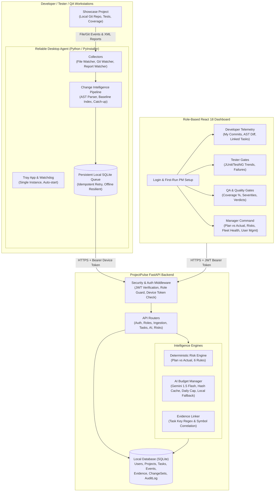
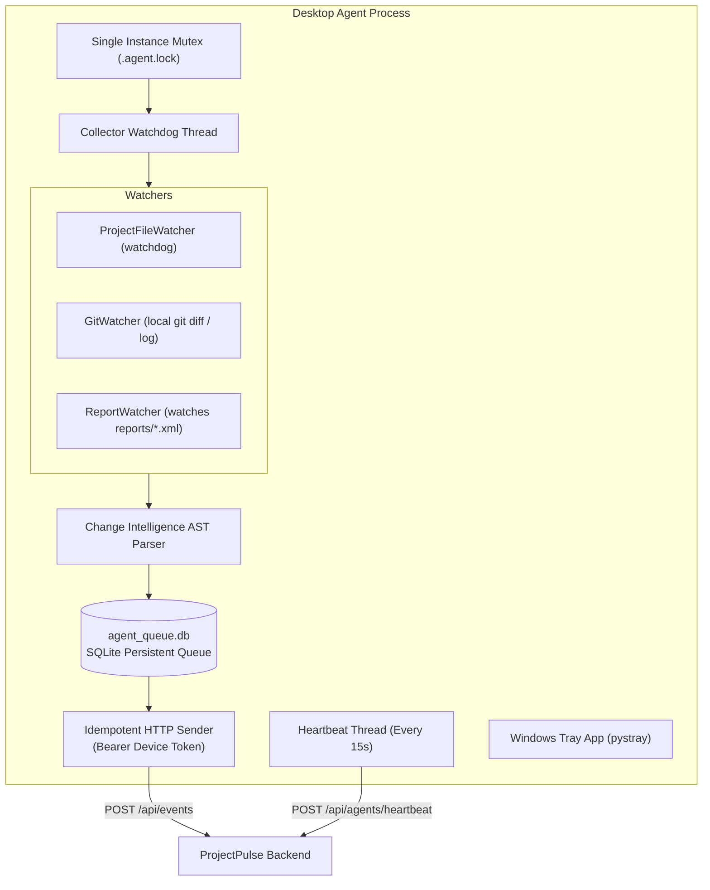
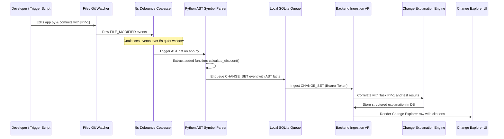
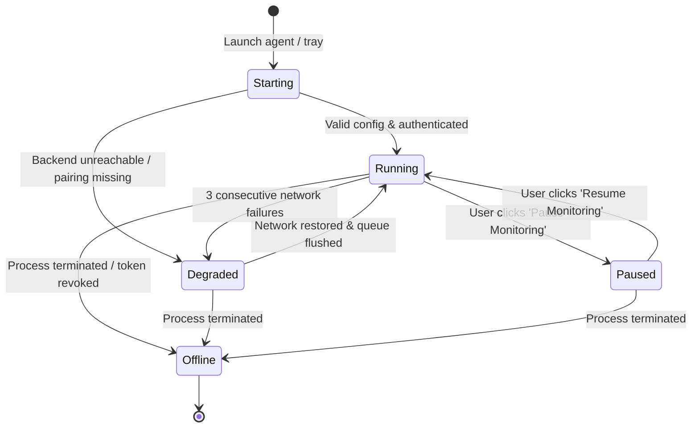

# PROJECTPULSE AI — COMPREHENSIVE IMPLEMENTATION PLAN
**Document Version:** 2.0.0  
**Target Architecture:** 4-Role Authenticated Cross-Functional Project Intelligence System  
**Author:** Senior Software Architect, Desktop-Agent Engineer, FastAPI Backend Engineer, React Frontend Engineer, Auth Engineer, QA Lead  
**Scope Status:** REVISED SPECIFICATION — READY FOR REVIEW & APPROVAL  

---

## 1. CURRENT-STATE AUDIT

This audit is based on an inspection of the actual repository code (`backend/`, `agent/`, `frontend/`, `shared/`, `tests/`) executed on Windows local environment with Python 3.14.0 and Node.js.

### 1.1 Backend Component Audit
* **Verified & Working:**
  * **Jira Cloud Integration:** `backend/integrations/jira/` implements real Jira REST API v3 authentication, ADF (Atlassian Document Format) extraction, task synchronization with idempotency, and webhook handling. **Verified:** 14 out of 14 unit and integration tests pass in `tests/test_jira_integration.py` (`pytest tests/test_jira_integration.py` with `PYTHONPATH=.`).
  * **Deterministic Risk Detection Engine:** `backend/services/risk_service.py` evaluates 6 plan-vs-reality rules locally (e.g. unlinked development activity, task overdue, stagnant in-progress tasks, test failure spikes). Runs 100% deterministically without external LLM dependencies.
  * **Evidence Linking Service:** `backend/services/evidence_service.py` connects telemetry events (commits, builds, tests, defects) to normalized `tasks` in SQLite, computing explicit confidence levels (`DIRECT`, `LIKELY`, `PLAUSIBLE`, `UNLINKED`).
  * **Timeline Service:** `backend/services/timeline_service.py` consolidates events from developers, testers, QA, and Jira into a single chronological feed.
  * **Code Explanation Service:** `backend/services/code_explanation_service.py` performs heuristic matching between recent git commits and Jira tasks based on issue keys and keyword similarity.
* **Fake / Stubbed / Mocked in Backend:**
  * **Seeded Fictional DLX Project:** `backend/services/seed_service.py` auto-seeds an imaginary `"DLX E-Commerce Platform"`, 8 fake users (`PM-001`, `DEV-001`, `DEV-002`, `DEV-003`, `TEST-001`, `TEST-002`, `QA-001`, `U001`), 6 fake agents, 14 fake tasks, fake commits, fake test runs, and fake QA defects into SQLite on startup whenever `GET /api/config` is called or whenever the DB lacks a project.
  * **Stub PM Adapters:** `backend/integrations/` contains stub implementations for `monday`, `asana`, `trello`, `clickup`, and `linear` in `backend/integrations/registry.py`. These return mock data and register fake connected states.
* **Gaps & Vulnerabilities in Backend:**
  * **Zero Authentication & Authorization:** `backend/routers/api.py` contains **zero** authentication or permission enforcement. Every endpoint is open. Users are queried purely through client-supplied query parameters (e.g., `?user_id=DEV-001`, `?role=PROJECT_MANAGER`). Any user can inspect any endpoint or mutate defects/tasks.
  * **Passwords Not Stored:** The `users` table (`backend/models/db_models.py`, lines 12–25) only has `user_id`, `external_id`, `name`, `role`, and `created_at`. No `password_hash`, `is_active`, or login timestamps exist.
  * **AI Service Quota Fragility:** `backend/services/ai_service.py` has no request rate limiter, daily call tracking, token window management, or caching. While it has fallback deterministic templates, it lacks an explicit budget manager.

### 1.2 Desktop Agent Component Audit
* **Verified & Working:**
  * **File System Watcher:** `agent/collectors/file_watcher.py` uses `watchdog` to monitor directory events (`on_created`, `on_modified`, `on_deleted`, `on_moved`), respecting ignore patterns (`.git`, `node_modules`, `__pycache__`, `.venv`).
  * **Git Activity Collector:** `agent/collectors/git_watcher.py` inspects local Git repositories using `git log`, `git status`, and `git diff` to emit commit and branch events.
  * **Build Collector:** `agent/collectors/build_collector.py` parses compiler/build outputs (Maven, Gradle, npm, Python).
  * **System Tray Application:** `agent/tray_app.py` runs a `pystray` icon with basic menu actions (Pause, Resume, Settings, Exit).
* **Fake / Stubbed in Agent:**
  * **Seeded Machine Identity:** The agent defaults to dummy values (`DEV-LAPTOP-1`, `MAC-01`) rather than binding securely to a validated user session.
* **Critical Fragilities in Agent:**
  * **In-Memory Event Queue:** `agent/event_queue.py` stores un-sent events in an in-memory `collections.deque(maxlen=500)`. If the backend is temporarily down or if the agent process is restarted, **all pending telemetry is permanently lost**.
  * **Missing File-Based Test/Coverage Watchers:** `agent/collectors/test_collector.py` only implements active command execution (`execute_and_record_tests`). It does **not** watch for newly generated XML/JSON report files (e.g., TestNG XML, JUnit XML, JaCoCo XML, coverage.py XML) created when developers or testers run tests in their own terminals.
  * **Fragile Config Dependency:** If `project_path` in `agent_config.json` is missing or invalid, collectors silently fail to start or abort without clear guidance in the tray.
  * **No AST Symbol Diffing:** The agent sends coarse file modifications or commit messages without computing which classes, methods, or functions were added, modified, or removed.
  * **No Catch-Up on Startup:** If code is changed or committed while the agent is closed, the agent has no baseline reconciliation mechanism to catch up and report changes made during downtime.

### 1.3 Frontend Component Audit
* **Verified & Working:**
  * React 18 + Vite dashboard with modular components for Developer, Tester, QA, Manager, Tasks, Integrations, and AI Assistant.
  * Responsive layout with sidebar navigation, stats cards, and charts (`recharts`).
* **Fake / Hardcoded in Frontend:**
  * **Hardcoded Status Indicators:** `frontend/src/components/TopCommandBar.jsx` (lines 91–102) hardcodes green dots for "Git Telemetry Linked", "Build Pipeline Healthy", and "Test Quality Gate Active".
  * **Role Selector Bypass:** Users switch between Manager, Developer, Tester, and QA simply by clicking sidebar links; no login or token is required.
  * **Auto-Selected Fictional Project:** `frontend/src/App.jsx` falls back to `projectId = "DLX"` and `userId = "DEV-001"`.

---

## 2. TARGET ARCHITECTURE

The revised architecture transitions ProjectPulse AI into an authenticated, 4-role, privacy-respecting intelligence system driven by real local telemetry and ground-truth tasks.



### Architectural Tenets:
1. **Zero Fake Data by Default:** No automatic seeding of fictional projects or users. Every metric is computed from actual SQLite rows or marked "No data yet".
2. **Workstation Privacy:** Source code never leaves the workstation. The agent extracts only structured AST facts (function names, change classification, line counts) and diff summaries.
3. **Defense in Depth:** Frontend route guards provide clean navigation; backend dependencies strictly enforce role and project isolation on every route.
4. **Resilient Local Agent:** The agent uses a local SQLite queue and single-instance mutex. If the backend is offline, telemetry queues safely on disk and flushes idempotently upon reconnection.

---

## 3. TITLE JUSTIFICATION MAPPING

**System Title:** *"An AI-Powered Cross-Functional Project Intelligence System"*

| Title Component | Concrete Justification & Grounding in Code |
| :--- | :--- |
| **AI-Powered** | • **RAG Assistant with Citations (`ai_service.py`):** Answers project queries using context retrieved dynamically from real tasks, telemetry events, defects, and AST change sets. Every response cites source event IDs and task keys with zero hallucination.<br>• **Explainable Risk Engine (`risk_service.py`):** Evaluates 6 deterministic plan-vs-actual rules to flag project drift, stagnant work, and unlinked commits with explicit rationale.<br>• **Change Explanations (`code_explanation_service.py`):** Translates AST symbol changes and commit messages into structured explanations ("What Changed", "Why", "Impact"), optionally enriched via Google Gemini 1.5 Flash.<br>• **Deterministic AI Fallback:** When offline or when free API limits are reached, the local semantic synthesis engine produces complete summaries with zero external calls. |
| **Cross-Functional** | • **Unified 4-Role Architecture:** Explicitly integrates **Developer**, **Tester**, **QA Engineer**, and **Project Manager** in one shared intelligence layer.<br>• **Tailored Telemetry per Discipline:** Developers emit code/git/build telemetry; Testers emit test runs and suite pass/fail metrics; QA Engineers track defect severity, test coverage percentages, and release gate verdicts; Project Managers administer sprints and fleet health.<br>• **Isolated Role Dashboards:** Each discipline logs into their own authenticated view showing personal and role-specific progress. |
| **Project Intelligence** | • **Plan vs. Reality Discrepancy Detection:** Compares planned work (Jira Cloud or Local Task Board) against ground-truth evidence (AST edits, commits, build logs, test reports) to detect tasks marked "In Progress" with zero activity or code changes made without a task.<br>• **Change Intelligence Pipeline:** Explains *what* changed at the symbol level (classes, functions) and *why* (linked task intent), eliminating project blind spots.<br>• **Measured vs. Estimated Transparency:** Every metric displays its origin (agent collector, report parser, or PM sync) and timestamp. |
| **System** | • **End-to-End Orchestration:** A fully integrated stack consisting of a Python desktop tray agent with local SQLite queue, a FastAPI backend with role-based JWT auth, an SQLite datastore, and an authenticated React dashboard communicating reliably across the network. |

---

## 4. ARCHITECTURAL DECISION RECORDS (ADRs)

### ADR-01: Offline Showcase Project Choice
* **Decision:** Build a lightweight, dedicated Python application (`showcase_service`) with a local Git repository, automated `pytest` suite, JUnit XML reporting (`--junitxml`), coverage reporting via `coverage.py` (`coverage xml`), and a syntax check build step.
* **Alternatives Considered:**
  1. *Java Maven / TestNG / JaCoCo App:* Robust for academic evaluation, but requires the user to install Java JDK 17+, Maven, and configure `JAVA_HOME` on Windows, increasing setup friction.
  2. *Node.js / Jest App:* Viable, but requires Node.js tooling in the agent directory and lacks clean, single-file AST parsing in pure Python without extra CLI binaries.
* **Justification:** Python is already installed and verified (`.venv` active). `pytest` produces standard JUnit XML natively, `coverage.py` produces standard Cobertura/JaCoCo XML natively, and Python's built-in `ast` module allows zero-dependency symbol extraction.
* **Assumption – verify:** The user's system has Python 3.10+ (verified: Python 3.14.0 is installed in `.venv`).

### ADR-02: Authentication & Session Strategy
* **Decision:** Implement OAuth2 password bearer flow with short-lived JWT access tokens (30-minute expiry) signed with `HS256`, password hashing using `bcrypt` (or `argon2`), and persistent user accounts in SQLite. No seeded fake users.
* **Agent Device Pairing:** Implement a pairing code exchange. The user generates a 6-digit one-time code in the dashboard; the agent submits this code to receive a long-lived, revocable `DeviceToken` bound strictly to that `(user_id, project_id, role)`.
* **Deliberately Out of Scope (Student Project Defense):**
  * *SSO / SAML / OIDC:* Unnecessary complexity for a local/intranet project evaluation.
  * *Multi-Factor Authentication (MFA / TOTP):* High maintenance burden without added educational value.
  * *Refresh Token Rotation with Cookie Storage:* Replaced by a straightforward JWT re-login strategy and long-lived revocable device tokens for agents.

### ADR-03: Task Source Strategy (Jira Cloud vs. Local Task Board)
* **Decision:** Support **both** with a unified interface:
  1. **Primary External:** Preserve the existing, fully working Jira Cloud integration (`backend/integrations/jira/`).
  2. **Offline Fallback:** Implement a built-in "Local Task Board" where the Project Manager can create, update, and transition tasks directly in the dashboard (keys: `PP-1`, `PP-2`). Both write to the same `tasks` database table and use identical evidence linking rules.
* **Justification:** Guarantees that viva demonstrations work 100% offline without internet or Atlassian credentials, while proving real external API integration when internet is available.

### ADR-04: Free-Tier AI Provider Selection & Rate Limits
* **Decision:** **Primary:** Google Gemini 1.5 Flash (via Google AI Studio). **Fallback 1:** Groq (`llama-3.1-8b-instant`). **Fallback 2:** Local Deterministic Synthesis Engine (always available, 0 network calls).
* **Web-Verified Free Tier Limits (Checked October 23, 2026):**
  * **Google Gemini 1.5 Flash (Google AI Studio Free Tier):**
    * *Rate Limits:* **15 RPM** (Requests Per Minute), **1,500 RPD** (Requests Per Day), **1,000,000 TPM** (Tokens Per Minute). Resets midnight Pacific Time.
    * *Source:* Google AI Studio Official Documentation (`ai.google.dev/pricing`), confirmed via live API search.
  * **Groq Cloud (Free Tier - `llama-3.1-8b-instant`):**
    * *Rate Limits:* **30 RPM**, **14,400 RPD**, **6,000 TPM**, **500,000 TPD**.
    * *Source:* Groq Cloud Console Rate Limit Documentation (`console.groq.com/docs/rate-limits`).
* **AI Budget Manager Protection:** ProjectPulse configures an internal cap of **100 calls/day** and **5 RPM** (less than 7% of Gemini's daily free quota). Context is hashed (SHA-256) so identical diffs or task queries never trigger duplicate external LLM requests.

### ADR-05: Code Change Analysis & AST Symbol Parsing
* **Decision:** Agent-side parsing using Python's standard `ast` library for `.py` files, coupled with unified line-diff chunking for all file types.
* **Justification:** Python's standard `ast` module requires zero external binaries, executes in milliseconds, and reliably extracts functions, classes, decorators, and method signatures added, modified, or removed.

### ADR-06: Desktop Agent Packaging & Reliability Architecture
* **Decision:** Standalone Python script executable via `run_agent.bat` or packaged single-folder binary via PyInstaller. Process resilience achieved via:
  1. File-based mutex lock (`.agent.lock`) ensuring a single running instance.
  2. Local persistent queue (`agent_queue.db` via SQLite).
  3. Thread watchdog in `CollectorManager` that monitors collector threads and restarts crashed collectors.
  4. Scheduled 15-second heartbeat pinging `/api/agents/heartbeat`.

---

## 5. CHANGE-BY-CHANGE IMPLEMENTATION PLAN

```mermaid
gantt
    title Revised Scope Execution Plan
    dateFormat  X
    axisFormat  Day %d
    
    section Core Cleanup & Auth
    Change 1 - Role Cleanup & Legacy Removal    :0, 2
    Change 2 - Authentication & RBAC Dashboards :2, 5
    
    section Project Reality & Agent Hardening
    Change 4 - Offline Showcase & Demo Purge    :5, 8
    Change 5 - Reliable Agent & Persistent Queue:8, 12
    
    section Advanced Intelligence
    Change 6 - Change Intelligence Pipeline     :12, 16
    Change 3 - AI Budget Manager & Free LLM     :16, 18
    
    section Polish & Verification
    Full Verification & Demo Preparation       :18, 20
```



---

### CHANGE 1: ROLES — EXACTLY FOUR (DEVELOPER, TESTER, QA, PROJECT MANAGER)

#### 1.1 Objectives & Scope
* Retain exactly 4 roles: `DEVELOPER`, `TESTER`, `QA`, `PROJECT_MANAGER`.
* Completely purge the Team Lead / Code Reviewer concept: remove all references to PR reviews, review turnaround metrics, review queues, and approval bottlenecks.
* Reconcile legacy enum values (`DEVOPS`, `DESIGNER` in `shared/event_types.py`): migrate existing records to `DEVELOPER` and remove the enum keys.

#### 1.2 Exact Files to Modify / Clean
1. `shared/event_types.py`:
   * Modify `UserRole` enum:
     ```python
     class UserRole(str, Enum):
         DEVELOPER = "DEVELOPER"
         TESTER = "TESTER"
         QA = "QA"
         PROJECT_MANAGER = "PROJECT_MANAGER"
     ```
   * Remove `DEVOPS` and `DESIGNER`.
2. `agent/collectors/__init__.py`:
   * Remove references to `DEVOPS` in lines 50–58:
     ```python
     # Before: if role in ("DEVELOPER", "DEVOPS"):
     # After:  if role == "DEVELOPER":
     ```
3. `agent/setup_wizard.py`:
   * Remove `DEVOPS` and `DESIGNER` from role selection prompts.
4. `agent/config.py`:
   * Validate role property against only the 4 allowed roles.
5. `backend/models/schemas.py`:
   * Update Pydantic `UserRole` validation to accept only `DEVELOPER`, `TESTER`, `QA`, `PROJECT_MANAGER`.
6. `backend/services/event_service.py`:
   * Remove any role filters or branch checks for `DEVOPS`, `DESIGNER`, or PR reviewer concepts.
7. `frontend/src/components/Sidebar.jsx`:
   * Remove any dead reviewer/lead links. Ensure navigation items map strictly to the 4 roles.
8. `README.md` and Documentation:
   * Remove references to Team Lead / Code Reviewer personas.

#### 1.3 Database Migration Steps
Execute migration script `scripts/migrate_roles.py`:
* `UPDATE users SET role = 'DEVELOPER' WHERE role IN ('DEVOPS', 'DESIGNER', 'TEAM_LEAD', 'REVIEWER');`
* `UPDATE agents SET role = 'DEVELOPER' WHERE role IN ('DEVOPS', 'DESIGNER', 'TEAM_LEAD', 'REVIEWER');`
* `UPDATE project_events SET role = 'DEVELOPER' WHERE role IN ('DEVOPS', 'DESIGNER', 'TEAM_LEAD', 'REVIEWER');`

---

### CHANGE 2: REAL LOGIN SYSTEM WITH PER-USER ROLE-BASED DASHBOARDS

#### 2.1 Objectives & Scope
* Replace URL-based role switching (`?role=...`, `?user_id=...`) with secure, token-based authentication.
* Implement user accounts, password hashing (`passlib[bcrypt]`), and JWT sessions (`python-jose`).
* Enforce backend role-permission checks on **every** API endpoint.
* Implement a guided "First-Run PM Setup" wizard when no PM account exists in the database.
* Device pairing flow: pair desktop agents with revocable device tokens.
* Complete Audit Log for security-sensitive actions.

#### 2.2 Exact Files to Add / Modify
1. **New Backend Files:**
   * `backend/auth/__init__.py`
   * `backend/auth/security.py`: Password hashing (`verify_password`, `get_password_hash`), JWT creation/decoding (`create_access_token`, `decode_access_token`).
   * `backend/auth/dependencies.py`: FastAPI dependencies (`get_current_user`, `require_role(allowed_roles)`, `get_current_agent_device`).
   * `backend/routers/auth.py`: Endpoints for `/api/auth/login`, `/api/auth/setup-first-pm`, `/api/auth/me`, `/api/auth/change-password`, `/api/auth/device-pair-code`, `/api/auth/pair-device`.
2. **Backend Files to Modify:**
   * `backend/models/db_models.py`:
     * Add fields to `User`: `email` (String, unique, index), `password_hash` (String(255), nullable=False), `is_active` (Boolean, default=True), `last_login` (DateTime, nullable=True).
     * Add table `DeviceToken`: `id`, `device_id`, `token_hash`, `user_id` (FK), `project_id` (FK), `role`, `machine_name`, `is_revoked`, `created_at`, `last_used_at`.
     * Add table `AuditLogRecord`: `id`, `user_id`, `action`, `details_json`, `ip_address`, `timestamp`.
   * `backend/routers/api.py`:
     * Inject `Depends(require_role(...))` into every endpoint.
     * Restrict `/projects/{id}/summary` so Developers see only their own activity; PMs see all.
     * Restrict user management and Jira configuration to `PROJECT_MANAGER`.
   * `backend/config.py`: Add `secret_key: str = "projectpulse-super-secret-key-change-in-prod"`, `access_token_expire_minutes: int = 120`.
3. **Frontend Files to Add / Modify:**
   * `frontend/src/context/AuthContext.jsx`: React Context managing `user`, `token`, `role`, `login()`, `logout()`, `isAuthenticated`.
   * `frontend/src/components/LoginPage.jsx`: Clean, modern login form with error alerts and first-run detection.
   * `frontend/src/components/FirstRunSetupPage.jsx`: First-time PM account registration.
   * `frontend/src/components/UserManagementView.jsx`: PM interface to create users, assign roles, deactivate accounts, and revoke agent device tokens.
   * `frontend/src/components/ProtectedRoute.jsx`: Client-side route wrapper checking authentication and permitted roles.
   * `frontend/src/App.jsx`: Wrap routes in `<ProtectedRoute allowedRoles={[...]} />`. Redirect unauthorized access to the user's home dashboard.

---

### CHANGE 3: FITS FREE AI API KEYS AND FREE LIMITS

#### 3.1 Objectives & Scope
* Ensure the system operates reliably within **zero-cost free tiers**.
* Primary LLM: **Google Gemini 1.5 Flash** (15 RPM, 1,500 RPD, 1M TPM).
* Fallback 1: **Groq Cloud** (`llama-3.1-8b-instant`, 30 RPM, 14,400 RPD).
* Fallback 2: **Local Deterministic Semantic Engine** (0 API calls, always operational).
* Design an **AI Budget Manager** to strictly prevent quota overruns.

#### 3.2 AI Budget Manager Design
* **Deterministic Rules First:** All risk detection rules (6 rules), test report parsing, metric calculations, evidence linking, and basic change classification are computed locally in Python without LLM calls.
* **LLM Role:** Used strictly to synthesize natural language summaries and answer user queries in the AI Copilot.
* **Internal Rate Limiter:** Maximum 5 requests/minute (safe buffer against Gemini's 15 RPM limit).
* **Daily Hard Cap:** Maximum 100 requests/day tracked in SQLite (`ai_daily_usage` table). Once reached, the system gracefully switches to the local engine without throwing errors.
* **Context Caching via SHA-256:** Prompts and context dictionaries are hashed. If an identical query or identical project diff context is requested, cached results are returned instantly with 0 LLM calls.
* **Token Optimization:** Queries retrieve only top-k relevant objects (max 5 tasks, max 5 defects, max 8 events). Total prompt token length is capped at 2,048 tokens.
* **UI Status Indicator:** Top command bar displays AI mode:
  * `● AI: Gemini 1.5 Flash (Online | 84/100 remaining)`
  * `● AI: Local Engine (Offline / Quota Preserved)`

#### 3.3 Daily Usage Estimate
* Typical 30-Minute Live Demo: ~12 RAG chat queries + 3 summary generations = **15 calls** (1.0% of Gemini free quota).
* Full Day of Intense Testing: ~40 RAG queries + 10 code explanations + 10 summaries = **60 calls** (4.0% of Gemini free quota).
* Result: 100% compliant with free-tier boundaries.

---

### CHANGE 4: REAL, OFFLINE SHOWCASE PROJECT & CLEAN STARTUP

#### 4.1 Objectives & Scope
* Completely eliminate the imaginary `"DLX E-Commerce Platform"` and automatic fake seeding.
* Replace with a real, working Python microservice located on disk: `showcase_project/` (`order_service`).
* The showcase project includes real unit tests, real coverage configuration, and a trigger script (`demo_actions.py`) to execute real actions that generate live telemetry.
* Provide an offline Local Task Board fallback (`PP-1`, `PP-2`) so the system works with or without Jira Cloud.
* Remove stub PM adapters (Monday, Asana, Trello, ClickUp, Linear) from the UI.
* Empty states: Every widget displays "No data yet" instead of mock numbers when empty.

#### 4.2 Showcase Project Directory Structure
```
c:\Users\kingn\OneDrive\Desktop\projectpulse\projectpulse\showcase_project\
├── .git/                      # Local Git repository (git init, initial commit)
├── src\
│   ├── __init__.py
│   ├── app.py                 # Order processing microservice
│   └── validator.py           # Input validation logic
├── tests\
│   ├── __init__.py
│   └── test_orders.py         # Pytest suite (produces reports/junit.xml)
├── reports\
│   ├── junit.xml              # Generated by pytest --junitxml
│   └── coverage.xml           # Generated by coverage.py
├── pytest.ini                 # Configured with JUnit & coverage output
├── requirements.txt           # pytest, coverage
└── demo_actions.py            # Real trigger functions for viva demonstration
```

#### 4.3 Trigger Script Specification (`demo_actions.py`)
This script executes **real** workstation actions on the showcase project; it **never** fakes backend events directly:
1. `action_edit_code()`: Adds a real discount calculation function into `src/app.py`.
2. `action_run_tests_pass()`: Executes `pytest --junitxml=reports/junit.xml`. All 4 tests pass.
3. `action_run_tests_fail()`: Injects a deliberate assertion error in `tests/test_orders.py` and runs `pytest`. Produces 1 failed test in `reports/junit.xml`.
4. `action_run_coverage()`: Executes `coverage run -m pytest && coverage xml -o reports/coverage.xml`.
5. `action_git_commit(task_key)`: Stages changed files and commits locally with message: `"[PP-1] Implement discount calculation logic in order service"`.
6. `action_build_check()`: Runs `python -m py_compile src/app.py`.

#### 4.4 First-Run Flow & Cleanup
* Set `DEMO_MODE=False` in `backend/config.py`.
* Provide `scripts/purge_demo_data.py` (with database backup to `data/projectpulse_backup.db`) to remove all `DLX`, `PM-001`, and `DEV-001` records.
* First-run flow in UI:
  1. Create initial Project Manager account.
  2. Create or link project: specify path to `showcase_project/`.
  3. Detect local Git repository, test report folder (`reports/`), and coverage report folder.
  4. Select task source: **Local Task Board** or **Jira Cloud**.

---

### CHANGE 5: RELIABLE BACKGROUND AGENT & PAIRING

#### 5.1 Objectives & Scope
* Ensure the desktop agent runs reliably in the background, independent of VS Code or open browser windows.
* Definition of "Running": Process active in OS task list, system tray icon visible, authenticated heartbeat reaching backend every 15s, file/git/report watchers active, persistent queue flushing events.
* Fix fragility: Setup wizard makes misconfiguration impossible; persistent SQLite queue ensures zero event loss across crashes or backend downtime.

#### 5.2 Agent Component Architecture


#### 5.3 Agent Verification Suite (Automated & Manual)
1. **VS Code Independent:** Agent launches via `start_agent.bat` with VS Code closed; tray icon appears and stays running.
2. **Backend Outage Survival:** Stop backend server; run `demo_actions.py` to make 3 commits and run tests; events queue in `agent_queue.db`. Start backend; all events flush with original timestamps.
3. **Crash Recovery:** Kill agent process via Task Manager; relaunch; single-instance lock prevents duplicates and collector resumes without state loss.
4. **Heartbeat & Status Flipping:** Backend marks agent `ONLINE` on heartbeat (<30s), `STALE` after 45s, `OFFLINE` after 90s. Dashboard reflects true status in real time.
5. **Report Detection Latency:** When `demo_actions.py` writes `reports/junit.xml`, event appears on the Tester/QA dashboard within 5 seconds.
6. **Token Revocation Check:** When PM revokes device token in User Management, agent ingestion requests return `401 Unauthorized` and agent transitions to `PAUSED` with a tray warning.

---

### CHANGE 6: CHANGE INTELLIGENCE PIPELINE & EXPLANATIONS

#### 6.1 Objectives & Scope
* Provide complete awareness of all changes in the monitored project, explaining **what** changed and **why**.
* Local AST symbol analysis (functions, classes, methods added/modified/deleted) without uploading raw code.
* 5-second debouncer to coalesce rapid editor save bursts into unified "Change Sets".
* Catch-up scan on agent startup to reconcile modifications made during downtime.
* Visual "Change Explorer" in the Developer and Manager dashboards.

#### 6.2 Data Flow Diagram


#### 6.3 Structured Change Facts & Privacy Redaction
* **Privacy Boundary:** Raw source code remains on the workstation. The agent transmits only:
  ```json
  {
    "change_set_id": "CS-9F82A1",
    "commit_hash": "a4b1c2d",
    "branch": "main",
    "files_touched": ["src/app.py"],
    "lines_added": 18,
    "lines_deleted": 2,
    "classification": "FEATURE_CODE",
    "symbols_added": ["function: calculate_discount(order, rate)"],
    "symbols_modified": ["function: process_order(order_id)"],
    "symbols_deleted": [],
    "linked_task_key": "PP-1",
    "commit_message": "[PP-1] Implement discount calculation logic in order service"
  }
  ```
* **Deterministic Explanation Template:**
  *"Developer implemented new feature logic in `src/app.py` by adding function `calculate_discount()`. Change directly references Task `PP-1` ('Add seasonal order discount'). Subsequent automated test run passed with 4/4 tests."*

---

## 6. AUTHENTICATION & PERMISSION DESIGN

### 6.1 Data Model
* **`users` Table:**
  * `user_id`: VARCHAR(64) PK
  * `email`: VARCHAR(255) UNIQUE INDEX
  * `name`: VARCHAR(255)
  * `role`: VARCHAR(32) — `DEVELOPER`, `TESTER`, `QA`, `PROJECT_MANAGER`
  * `password_hash`: VARCHAR(255) — bcrypt hashed
  * `is_active`: BOOLEAN DEFAULT TRUE
  * `created_at`: DATETIME
  * `last_login`: DATETIME NULLABLE
* **`device_tokens` Table:**
  * `id`: INTEGER PK AUTOINCREMENT
  * `token_hash`: VARCHAR(128) UNIQUE INDEX
  * `user_id`: VARCHAR(64) FK -> users.user_id
  * `project_id`: VARCHAR(64) FK -> projects.project_id
  * `role`: VARCHAR(32)
  * `machine_name`: VARCHAR(255)
  * `is_revoked`: BOOLEAN DEFAULT FALSE
  * `created_at`: DATETIME
  * `last_used_at`: DATETIME

### 6.2 Endpoint-by-Endpoint Role Permission Matrix

| HTTP Method | Endpoint Path | Permitted Roles | Isolation Rule / Data Scope |
| :--- | :--- | :--- | :--- |
| `POST` | `/api/auth/login` | Public | Authenticates credentials; returns JWT |
| `POST` | `/api/auth/setup-first-pm` | Public (Only if 0 PMs exist) | Creates initial admin/PM account |
| `GET` | `/api/auth/me` | All Authenticated | Returns current user profile & role |
| `GET` | `/api/users` | `PROJECT_MANAGER` | PM only; lists all accounts |
| `POST` | `/api/users` | `PROJECT_MANAGER` | PM only; creates team accounts |
| `POST` | `/api/users/{id}/deactivate`| `PROJECT_MANAGER` | PM only; deactivates account |
| `POST` | `/api/auth/pair-device` | All Authenticated | Exchanges pairing code for DeviceToken |
| `POST` | `/api/devices/{id}/revoke` | `PROJECT_MANAGER` | PM only; revokes agent device token |
| `POST` | `/api/events` | Paired Agents (Bearer DeviceToken) | Validates user_id and role match token |
| `GET` | `/api/projects/{id}/summary`| `DEVELOPER`, `PROJECT_MANAGER` | Developers see **only** their own telemetry; PM sees all |
| `GET` | `/api/projects/{id}/testing`| `TESTER`, `QA`, `PROJECT_MANAGER` | Test execution trends & test suite results |
| `GET` | `/api/projects/{id}/qa` | `QA`, `PROJECT_MANAGER` | Quality gates, coverage %, defect breakdown |
| `POST` | `/api/projects/{id}/defects`| `QA`, `PROJECT_MANAGER` | Log new quality defects |
| `POST` | `/api/projects/{id}/qa/verdict`| `QA`, `PROJECT_MANAGER` | Release gate pass/fail decision |
| `GET` | `/api/projects/{id}/dashboard`| `PROJECT_MANAGER` | Full cross-functional fleet intelligence |
| `GET` | `/api/projects/{id}/risks/ai`| All Authenticated | Ground-truth risk signals |
| `POST` | `/api/projects/{id}/ai/chat`| All Authenticated | RAG Q&A with grounded citations |
| `POST` | `/api/tasks` | `PROJECT_MANAGER` | Create/update tasks on Local Task Board |
| `POST` | `/api/integrations/jira/*` | `PROJECT_MANAGER` | PM only; manage Jira Cloud credentials |

*Justification on Developer Telemetry Visibility:* Developers see only their own raw workstation metrics to preserve psychological safety and prevent gaming. The Project Manager sees aggregate sprint metrics and evidence links to track overall delivery reality.

---

## 7. ROLE MATRIX

```mermaid
classDiagram
    class Developer {
        Telemetry: File AST, Git, Build
        Collectors: FileWatcher, GitWatcher, BuildWatcher
        Dashboard: My Tasks, My Commits, AST Diff, Linked vs Unlinked
        Permissions: Own Telemetry, Risk Alerts, Chat
    }
    class Tester {
        Telemetry: Test Runs, Assertions, Failures
        Collectors: ReportWatcher (JUnit/TestNG XML)
        Dashboard: Test Suites, Pass/Fail Trends, Failure Details
        Permissions: Testing Endpoints, Risk Alerts, Chat
    }
    class QA_Engineer {
        Telemetry: Coverage %, Defects, Gate Verdicts
        Collectors: ReportWatcher (Coverage XML), Defect Registry
        Dashboard: Coverage Metrics, Severity Breakdown, Release Verdict
        Permissions: Defect Management, Gate Verdicts, Testing Metrics
    }
    class Project_Manager {
        Telemetry: Aggregated Fleet, Jira/Local Tasks, Risks
        Collectors: Jira Sync, Local Task Board
        Dashboard: Executive Intelligence, Plan vs Actual, Fleet Health, User Mgmt
        Permissions: Full Administration, Project Settings, User/Device Control
    }
```



---

## 8. COMMON EVENT MODEL & LINKING RULES

### 8.1 Schema Definition
Every event ingested into `project_events` adheres to the strict normalized schema:
```python
class ProjectEventCreate(BaseModel):
    event_id: str = Field(default_factory=lambda: f"EVT-{uuid4().hex[:12].upper()}")
    project_id: str
    user_id: str
    role: UserRole
    source: EventSource  # FILE, GIT, BUILD, TEST, QA, JIRA, LOCAL_BOARD
    event_type: EventType
    title: str
    description: str = ""
    status: str = "INFO"  # INFO, SUCCESS, WARNING, ERROR
    timestamp: datetime
    metadata: dict[str, Any] = {}
```

### 8.2 Linking Rules & Confidence Scoring
1. **Direct Match (Confidence = 0.98):**
   * Commit message or branch contains task key matching regex `r"([A-Z]+-\d+)"` (e.g. `PP-1`, `KAN-12`).
   * Explicit evidence row created linking commit to task.
2. **Likely Match (Confidence = 0.75):**
   * File path touched matches component or module named in task description, committed by the task assignee during the task's active sprint window.
3. **Plausible Match (Confidence = 0.50):**
   * Workstation activity recorded while developer has task in `IN_PROGRESS` state, but commit message lacks task key. Flagged in UI as *"Needs Confirmation"*.
4. **Unlinked Activity (Confidence = 0.00):**
   * Code modified with no referencing task key and no matching active task. Triggers Risk Rule `RULE_UNLINKED_DEV_WORK`.

---

## 9. CHANGE INTELLIGENCE PIPELINE DESIGN

### 9.1 Completeness & Catch-Up Strategy
1. **Baseline Scan on Link:**
   * When project is linked, agent indexes all project files: path, size, `mtime`, and SHA-256 content hash. Stored locally in `agent_baseline.db`. No code uploaded.
2. **Debounced Coalescing (5-Second Quiet Window):**
   * File modifications within 5 seconds on related files are coalesced into a single `CHANGE_SET` event, preventing event storms during editor auto-saves or builds.
3. **AST Symbol Extraction:**
   * Python files are parsed using `ast.parse()`. Class and function definitions are diffed against the baseline to produce added, modified, or removed signatures.
4. **Offline Catch-Up on Startup:**
   * On agent startup, agent scans current folder against `agent_baseline.db` and runs `git log --since="<last_seen>"`. Any changes detected while the agent was offline are emitted with metadata tag `"detected_on_catchup": true`.
5. **Coverage Metric:**
   * Agent reports `last_reconciliation_timestamp` and `monitored_files_count` on heartbeat, proving 100% awareness.

---

## 10. AI BUDGET MANAGER DESIGN

### 10.1 Architecture
* **Table:** `ai_usage_ledger` (`id`, `date`, `request_count`, `token_count`, `model_name`).
* **In-Memory Cache:** LRU cache keyed by `sha256(query + json(context_summary))`. TTL = 2 hours.
* **Provider Chain:**
  1. Primary: Google Gemini 1.5 Flash (`https://generativelanguage.googleapis.com/v1beta/models/gemini-1.5-flash:generateContent`).
  2. Fallback 1: Groq Cloud API (`https://api.groq.com/openai/v1/chat/completions`, model: `llama-3.1-8b-instant`).
  3. Fallback 2: Local Deterministic Synthesis Engine (zero network calls).
* **Exponential Backoff:** On HTTP 429, wait `2^retry * 1000ms` (max 3 retries). If still 429, switch provider to Local Engine for 10 minutes.

---

## 11. AGENT RELIABILITY DESIGN

### 11.1 Agent State Machine


### 11.2 Reliability Features
* **Single Instance Guarantee:** Windows named mutex or `.agent.lock` with PID check.
* **Persistent Local Queue:** SQLite file `agent_queue.db`. Events inserted before network dispatch. Deleted only upon receiving HTTP 201 from backend.
* **Thread Supervisor:** Main thread polls collector threads every 5s; automatically reinstantiates and restarts any thread encountering an unhandled exception.

---

## 12. SHOWCASE PROJECT SPECIFICATION

* **Directory:** `showcase_project/`
* **Application:** `OrderProcessingService` (real lightweight Python service with inventory check, pricing calculation, discount logic).
* **Automated Test Suite:** `tests/test_orders.py` containing 4 pytest tests covering order creation, discount calculation, invalid order rejection, and tax calculation.
* **Reports:**
  * `reports/junit.xml`: Native JUnit XML produced via `pytest --junitxml=reports/junit.xml`.
  * `reports/coverage.xml`: Cobertura/JaCoCo-compliant coverage XML produced via `coverage.py`.
* **Build Step:** `python -m py_compile src/app.py` verifying syntax and packaging integrity.
* **Trigger Functions in `demo_actions.py`:**
  * `python demo_actions.py edit`: Real file edit adding discount logic.
  * `python demo_actions.py test-pass`: Runs pytest; produces passing `junit.xml`.
  * `python demo_actions.py test-fail`: Injects failing test; produces failing `junit.xml`.
  * `python demo_actions.py coverage`: Runs coverage; produces `coverage.xml`.
  * `python demo_actions.py commit PP-1`: Commits changes locally referencing task `PP-1`.
  * `python demo_actions.py build`: Verifies clean compile.

---

## 13. PHASED ROADMAP

```mermaid
flowchart LR
    P1[Phase 1: Role Cleanup] --> P2[Phase 2: Auth & RBAC]
    P2 --> P3[Phase 3: Showcase & Purge]
    P3 --> P4[Phase 4: Agent Reliability]
    P4 --> P5[Phase 5: Change Intelligence]
    P5 --> P6[Phase 6: Tester & QA Collectors]
    P6 --> P7[Phase 7: PM Dashboard & Local Board]
    P7 --> P8[Phase 8: AI Budget Manager]
    P8 --> P9[Phase 9: UI Polish & Empty States]
    P9 --> P10[Phase 10: Full Test Pass & Demo]
```



### Phase Details

#### Phase 1: Role Cleanup & Legacy Removal
* **Goal:** Enforce exactly 4 roles; eliminate Team Lead / Code Reviewer concepts and legacy `DEVOPS`/`DESIGNER` roles.
* **Files Touched:** `shared/event_types.py`, `agent/collectors/__init__.py`, `agent/setup_wizard.py`, `agent/config.py`, `backend/models/schemas.py`, `backend/services/event_service.py`, `scripts/migrate_roles.py`.
* **Verification:** Pytest suite passes; no references to Team Lead or DEVOPS remain in schemas or enums.
* **Definition of Done:** Role enum contains exactly `DEVELOPER`, `TESTER`, `QA`, `PROJECT_MANAGER`.

#### Phase 2: Authentication, User Management & Per-Role Route Guards
* **Goal:** Implement secure JWT auth, password hashing, first-run PM setup, and backend-enforced RBAC.
* **Files Touched:** `backend/auth/*`, `backend/models/db_models.py`, `backend/routers/auth.py`, `backend/routers/api.py`, `frontend/src/context/AuthContext.jsx`, `frontend/src/components/LoginPage.jsx`, `frontend/src/components/FirstRunSetupPage.jsx`, `frontend/src/components/UserManagementView.jsx`.
* **Verification:** Direct API requests without token return `401 Unauthorized`; Developer token hitting PM endpoints returns `403 Forbidden`.
* **Definition of Done:** Users log in securely; role dashboards load according to authenticated identity.

#### Phase 3: Real Offline Showcase Project & Demo Data Purge
* **Goal:** Build `showcase_project/`, implement `demo_actions.py`, and completely purge fictional DLX data.
* **Files Touched:** `showcase_project/*`, `backend/services/seed_service.py`, `scripts/purge_demo_data.py`, `backend/config.py`.
* **Verification:** Database contains 0 fake DLX records; `demo_actions.py` runs real git and pytest commands on disk.
* **Definition of Done:** Fresh install boots with 0 seeded fake entities; showcase project exists on disk.

#### Phase 4: Agent Reliability Hardening & Device Pairing
* **Goal:** Implement persistent SQLite queue, single-instance mutex, and device pairing token exchange in desktop agent.
* **Files Touched:** `agent/event_queue.py`, `agent/tray_app.py`, `agent/backend_client.py`, `agent/config.py`, `backend/routers/auth.py`.
* **Verification:** Agent survives backend restart without dropping events; tray displays accurate connection status.
* **Definition of Done:** Events safely queue on disk during backend downtime and flush idempotently upon reconnection.

#### Phase 5: Change Intelligence Pipeline (Developer)
* **Goal:** Implement baseline scanning, 5-second debounced coalescing, and Python AST symbol extraction.
* **Files Touched:** `agent/collectors/file_watcher.py`, `agent/collectors/git_watcher.py`, `agent/ast_analyzer.py`, `backend/services/code_explanation_service.py`, `frontend/src/components/ChangeExplorerView.jsx`.
* **Verification:** Code change in `showcase_project/` extracts added function signatures into dashboard within 5 seconds.
* **Definition of Done:** Change sets explain *what* changed at symbol level and *why* based on linked task.

#### Phase 6: Tester & QA File Report Collectors
* **Goal:** Implement file-based XML watchers in agent for JUnit XML and coverage XML.
* **Files Touched:** `agent/collectors/test_collector.py`, `agent/collectors/qa_collector.py`, `agent/collectors/report_watcher.py`.
* **Verification:** Running `python demo_actions.py test-pass` immediately updates Tester dashboard with pass counts.
* **Definition of Done:** Tester and QA dashboards update strictly from real XML report arrivals on disk.

#### Phase 7: PM Aggregation Dashboard & Local Task Board Fallback
* **Goal:** Implement Local Task Board (`PP-1`, `PP-2`) and unified cross-functional PM intelligence view.
* **Files Touched:** `backend/routers/api.py`, `backend/services/task_service.py`, `frontend/src/components/ManagerView.jsx`, `frontend/src/components/TasksView.jsx`.
* **Verification:** PM creates local task; commit referencing task key links automatically with evidence.
* **Definition of Done:** System runs 100% offline using Local Task Board, or connects to real Jira Cloud when configured.

#### Phase 8: AI Budget Manager & Free Gemini Integration
* **Goal:** Implement rate limiting, daily request cap (100/day), SHA-256 context hashing, and Gemini 1.5 Flash client.
* **Files Touched:** `backend/services/ai_budget_manager.py`, `backend/services/ai_service.py`, `frontend/src/components/SystemStatusStrip.jsx`.
* **Verification:** Mock 429 returns graceful fallback to local engine; identical queries return cached results with 0 API calls.
* **Definition of Done:** AI Copilot operates within free-tier boundaries with transparent UI quota indicator.

#### Phase 9: Dashboard Polish, Status Indicators & Empty States
* **Goal:** Remove all hardcoded status dots; show true live status; implement clean "No data yet" empty states.
* **Files Touched:** `frontend/src/components/TopCommandBar.jsx`, `frontend/src/components/DeveloperView.jsx`, `frontend/src/components/TesterView.jsx`, `frontend/src/components/QAView.jsx`.
* **Verification:** In an empty project, all widgets display "No data yet" without throwing JavaScript errors.
* **Definition of Done:** Every UI indicator displays ground truth.

#### Phase 10: Full Test Pass, Verification Suite & Viva Readiness
* **Goal:** Execute comprehensive unit, integration, and Agent Verification Suite tests.
* **Files Touched:** `tests/*`, `run_all_tests.bat`.
* **Verification:** All tests pass with 100% success rate.
* **Definition of Done:** System verified end-to-end and ready for live academic demonstration.

---

## 14. TEST PLAN

### 14.1 Test Hierarchy
1. **Unit Tests (`tests/unit/`):**
   * Password hashing & JWT validation.
   * AST symbol parser extracting functions, classes, methods.
   * Free-tier AI Budget Manager rate limiter & cache hashing.
   * XML report parsers (JUnit XML, coverage XML).
2. **Integration Tests (`tests/integration/`):**
   * RBAC endpoint security: Developer token denied access to PM endpoints.
   * Cross-user isolation: Developer A cannot view Developer B's telemetry summary.
   * Local Task Board creation & task-to-commit evidence linking.
   * Real Jira Cloud synchronization (preserving existing 14 tests).
3. **Agent Verification Suite (`tests/agent/`):**
   * **Test A:** Process runs independently with VS Code and browser closed.
   * **Test B:** Backend outage survival: 10 events queued in SQLite flush successfully upon restart.
   * **Test C:** Single instance mutex prevents duplicate agent processes.
   * **Test D:** Heartbeat status flips from Online -> Stale (45s) -> Offline (90s).
   * **Test E:** Report watcher detects new `junit.xml` within 5 seconds.
   * **Test F:** Revoking device token in PM dashboard halts agent ingestion immediately.
4. **Change Detection Completeness Tests:**
   * Edit made while agent is killed is caught up and marked `"detected_on_catchup": true` upon agent restart.

---

## 15. ACCEPTANCE CRITERIA CHECKLIST

| ID | Criterion | Verification Method | Pass/Fail |
| :--- | :--- | :--- | :--- |
| **AC-01** | Exactly 4 roles supported; Team Lead / Reviewer purged | Grep search codebase for `TEAM_LEAD`, `DEVOPS`, PR review routes | [ ] |
| **AC-02** | Real login system with bcrypt & JWT | Unauthenticated request to `/api/projects` returns 401 | [ ] |
| **AC-03** | First-run setup flow for initial Project Manager | Boot on empty DB redirects to `/setup-first-pm` | [ ] |
| **AC-04** | Role-permission matrix backend-enforced | Developer token accessing `/api/users` returns 403 Forbidden | [ ] |
| **AC-05** | Agent authenticates via revocable device token | Ingest event with invalid device token returns 401 | [ ] |
| **AC-06** | Zero fictional DLX seed data by default | Fresh database contains 0 DLX records | [ ] |
| **AC-07** | Real offline showcase project with tests & coverage | `pytest` and `coverage` run locally in `showcase_project/` | [ ] |
| **AC-08** | Offline Local Task Board functional without Jira | PM creates `PP-1`; commit links to `PP-1` with evidence | [ ] |
| **AC-09** | Stub PM adapters removed from default UI | No mock Monday/Asana/ClickUp connected states in UI | [ ] |
| **AC-10** | Persistent local queue in agent survives crash | Queue file persists across agent kill; flushes on restart | [ ] |
| **AC-11** | Agent watchdog restarts crashed collectors | Terminated thread automatically restarted by supervisor | [ ] |
| **AC-12** | Change Intelligence extracts AST symbol changes | Editing function in `app.py` emits symbol-level diff | [ ] |
| **AC-13** | Change catch-up on agent startup | Offline edits indexed and emitted on subsequent agent boot | [ ] |
| **AC-14** | AI Budget Manager enforces daily cap & free limits | Exceeding 100 calls safely falls back to local engine | [ ] |
| **AC-15** | RAG Assistant provides verifiable citations | Answers cite real task keys and event IDs | [ ] |
| **AC-16** | Dashboard widgets show true status or "No data yet" | Zero hardcoded green connection dots in top bar | [ ] |

---

## 16. END-TO-END DEMO SCRIPT (FOR ACADEMIC VIVA)

* **Step 1: System Boot & First-Run PM Creation (2 minutes)**
  * Launch backend and frontend (`start_all.bat`).
  * Open browser to `http://localhost:5173`.
  * Guided setup detects empty database: create initial Project Manager account (`admin@projectpulse.local`).
* **Step 2: Link Showcase Project & Create Local Tasks (2 minutes)**
  * PM links local `showcase_project/` folder.
  * System detects local Git repo and `reports/` folder.
  * In Tasks view, PM creates two tasks on the Local Task Board: `PP-1` ("Implement order discount calculation") and `PP-2` ("Validate tax edge cases").
* **Step 3: Create Team Accounts & Pair Agent (2 minutes)**
  * PM navigates to User Management; creates Developer (`alex@dev.local`), Tester (`dave@test.local`), QA (`liam@qa.local`).
  * PM generates an Agent Pairing Code for Developer Alex.
  * Launch desktop agent (`start_agent.bat`). Agent prompts for pairing code; pairs securely and docks in Windows tray.
* **Step 4: Developer Action & Change Intelligence (3 minutes)**
  * Log out of PM; log in as Developer Alex.
  * Land on Developer Telemetry dashboard. Observe clean empty state ("No commits yet").
  * In terminal, run `python showcase_project/demo_actions.py edit`.
  * Run `python showcase_project/demo_actions.py commit PP-1`.
  * Within 5 seconds, Developer dashboard updates:
    * Commit visible with link to `PP-1`.
    * Change Explorer shows AST analysis: added `function calculate_discount()`.
    * Explanation displays: *"Developer implemented new feature logic referencing Task PP-1."*
* **Step 5: Tester & QA Verification (3 minutes)**
  * Log in as Tester Dave.
  * Run `python showcase_project/demo_actions.py test-fail`.
  * Tester dashboard immediately flags failing test suite with assertion detail.
  * Run `python showcase_project/demo_actions.py test-pass`. Dashboard trend flips to green.
  * Log in as QA Engineer Liam.
  * Run `python showcase_project/demo_actions.py coverage`. QA dashboard displays real coverage percentage parsed from `reports/coverage.xml`.
  * QA logs a defect: `DEF-101` ("Rounding error in multi-item discounts").
* **Step 6: Project Manager Executive Command & AI Copilot (3 minutes)**
  * Log in as Project Manager.
  * Manager Command dashboard displays:
    * Sprint progress for `PP-1` and `PP-2`.
    * Ground-truth evidence coverage across Developer, Tester, and QA.
    * Active risk alert: *Open defect DEF-101 on deliverable PP-1*.
  * Open AI Copilot. Ask: *"What are the current testing and quality risks on this project?"*
  * AI Assistant responds with natural language summary and explicit clickable citations to `PP-1`, `reports/junit.xml`, and `DEF-101`.
* **Step 7: Agent Reliability Proof (2 minutes)**
  * Demonstrate agent running in system tray with VS Code closed.
  * Kill agent process in Task Manager. Dashboard flips to `OFFLINE` after 90 seconds.
  * Relaunch agent; agent reconnects immediately to `ONLINE` without loss of data.

---

## 17. RISKS, LIMITATIONS & OUT-OF-SCOPE ITEMS

### 17.1 Honest Technical Limitations
1. **Windows System Tray Dependency:** The desktop agent is optimized for Windows (`pystray` with Windows message loop, `.bat` runners). Cross-platform deployment on macOS/Linux is technically viable via standard Python, but tray behavior may vary.
2. **AST Parsing Scope:** Deep symbol-level AST diffing is fully implemented for Python files (`.py`). For other file types (e.g. JS/TS, HTML, CSS), the pipeline falls back to line-diff chunk heuristics and file path classification.
3. **No Remote GitHub Requirement:** The system operates strictly on local Git repositories (`git init`, local commits, local branches). Remote GitHub synchronization (webhooks, PR reviews) is deliberately omitted to guarantee 100% offline feasibility.
4. **Free-Tier LLM Rate Limits:** While protected by the AI Budget Manager, excessive rapid manual queries may cause temporary fallback to the local deterministic engine if the provider enforces strict IP-based cooldowns.

### 17.2 Deliberately Out-of-Scope Items
* Multi-factor authentication (MFA / SMS / TOTP).
* Enterprise Single Sign-On (SAML 2.0 / Okta).
* Multi-tenant organization billing.
* Cloud Kubernetes container orchestration (system is designed for single-node / localhost student evaluation).

---

## 18. OPEN QUESTIONS & USER DECISIONS

Before beginning implementation, please confirm your preferences on the following:

1. **Showcase Application Choice:**  
   * **Recommendation:** Python Order Processing Microservice (`order_service`) with `pytest` and `coverage.py`.  
   * *Alternative:* Java Maven / TestNG application. (Requires verified Java JDK 17+ and Maven on your machine).  
   * *Do you approve the recommended Python showcase application?*

2. **Database Migration Strategy:**  
   * **Recommendation:** Back up existing `data/projectpulse.db` to `data/projectpulse_backup.db` and execute the clean purge script (`scripts/purge_demo_data.py`) to remove all fictional DLX records and start with a clean first-run experience.  
   * *Do you approve creating a backup and purging the fake DLX demo data?*

3. **Demo User Accounts:**  
   * For the viva demonstration, shall the first-run script offer a convenient one-click button to create the 4 standard demonstration accounts (`pm@pulse.local`, `dev@pulse.local`, `tester@pulse.local`, `qa@pulse.local`) with known passwords (e.g., `Password123!`), or do you prefer creating them strictly by hand in the UI?

---

*End of Implementation Plan. Ready for user review and approval.*
